# AI 기본기

규칙을 미리 넣는 방식과, 문제와 답을 주고 규칙을 찾게 하는 방식을 구분하려고 적은 공부 기록이다.

출처는 『케라스 창시자에게 배우는 딥러닝』 3판 1장이다. 교재 본문은 없다. 여기 있는 것은 공책, 블로그에 내가 쓴 말, 그 내용을 다시 그린 그림, 그리고 같은 예제를 이 PC에서 다시 돌린 숫자다.

작성: Youngchan Lee · [일기맨](https://blog.naver.com/caramel2516) · GitHub [JimProKing](https://github.com/JimProKing)

| 날짜 | 기록 |
| --- | --- |
| 2026-11-01 | [AI 기본이 되는 지식들](https://blog.naver.com/caramel2516/224461204391). 심볼릭 AI, 전문가 시스템, 머신러닝, 딥러닝 루프, 가설 공간 |
| 2026-11-06 | [연산과 텐서](https://blog.naver.com/caramel2516/224467641906), [경사하강법](https://blog.naver.com/caramel2516/224467643239) |
| 2026-11-10 | 같은 예제를 이 PC에서 다시 실행 |

이어서 한 실습: [MNIST](https://github.com/JimProKing/mnist-keras-notes) · [Whisper](https://github.com/JimProKing/whisper-local-notes)

## 세 갈래

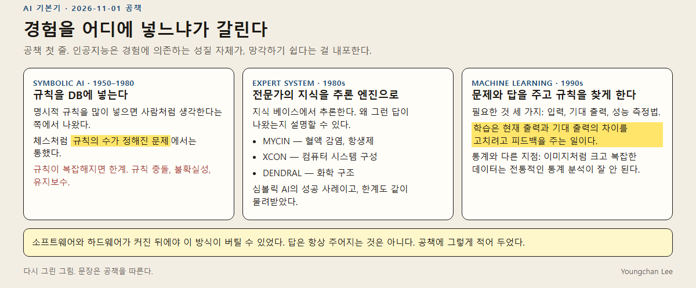

공책 첫 줄은 이렇다. 인공지능은 경험에 의존하고, 그래서 잊기도 한다.

- 심볼릭 AI (1950–1980). DB에 명시적 규칙을 넣는다. 체스처럼 규칙이 정해진 문제에서는 통했다. 규칙이 많아지면 규칙 충돌, 불확실성, 유지보수가 한계다.
- 전문가 시스템 (1980년대). 전문가의 지식 베이스로 추론 엔진을 만든다. 왜 그 답인지 설명할 수 있다. MYCIN(혈액 감염), XCON(컴퓨터 구성), DENDRAL(화학 구조). 심볼릭 AI의 성공이고, 한계도 같이 가져왔다.
- 머신러닝 (1990년대). 문제와 답을 주고 패턴을 찾게 한다. 필요한 것은 입력, 기대 출력, 성능 측정법. 학습은 현재 출력과 기대 출력의 차이를 고치려고 피드백을 주는 일이다. 답은 항상 주어지지는 않는다.

## 딥러닝 루프

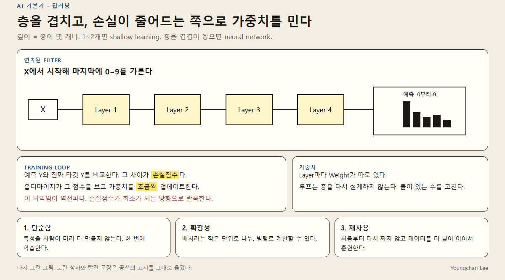

깊이는 층이 몇 개냐는 뜻이다. 1~2개면 shallow learning이고, 층을 겹겹이 쌓으면 neural network다.

예측과 타깃의 차이가 손실점수다. 옵티마이저가 그 점수를 보고 가중치를 조금씩 고친다. 공책에는 이 되먹임을 역전파라고 적어 두었다. 루프는 층을 다시 설계하지 않고, 들어 있는 수를 고친다.

공책에 세 가지로 적어 둔 이유:

1. 단순함. 특성을 사람이 미리 다 만들지 않고 한 번에 학습한다.
2. 확장성. 배치 단위로 나눠 병렬로 계산한다.
3. 재사용. 처음부터 다시 짜지 않고, 데이터를 더 넣어 이어서 훈련한다.

## 가설 공간

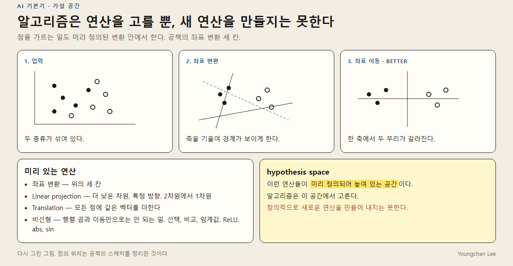

점을 가르는 변환도 미리 정의된 연산 안에서 한다. 좌표 변환, 더 낮은 차원으로의 linear projection, 모든 점에 같은 벡터를 더하는 translation, 그리고 행렬 곱과 이동만으로는 안 되는 비선형(ReLU, abs, sin).

hypothesis space는 그 연산들이 놓여 있는 공간이다. 알고리즘은 여기서 고른다. 새 연산을 스스로 만들지는 못한다. 위 그림의 점 위치는 공책 스케치를 정리한 것이고, 측정값이 아니다.

## 텐서

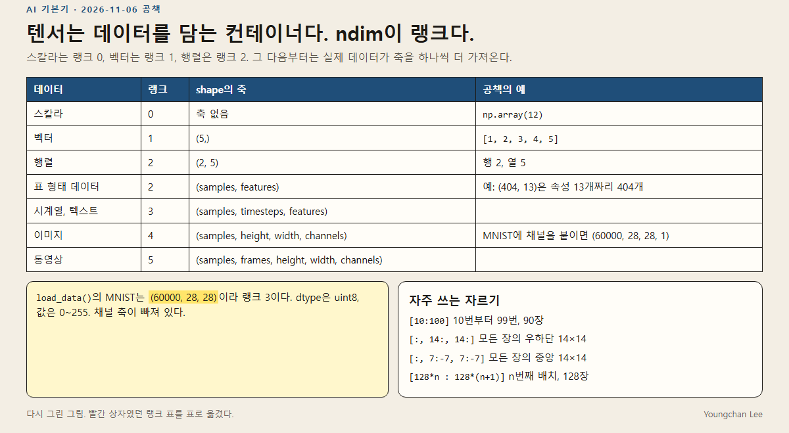

텐서는 데이터를 담는 컨테이너이고, `ndim`이 랭크다. MNIST를 `load_data()`로 읽으면 `(60000, 28, 28)`이라 랭크 3이다. 채널 축을 붙이면 `(60000, 28, 28, 1)`, 랭크 4가 된다. dtype은 `uint8`, 값은 0~255.

자주 쓰는 자르기:

- `images[10:100]` — 90장
- `images[:, 14:, 14:]` — 우하단 14×14
- `images[:, 7:-7, 7:-7]` — 중앙 14×14
- `images[128 * n : 128 * (n + 1)]` — n번째 배치

원소별 덧셈 `x + y`와 파이썬 이중 루프 `naive_add`는 같은 일이고, NumPy는 C로 된 BLAS를 탄다. 행렬 곱은 `x @ y`이고 원소별 곱 `*`과는 다르다. `(32, 10)`에 `(10,)`을 더하면 브로드캐스팅된다. `reshape`는 값을 바꾸지 않고 모양만 바꾼다.

## 경사하강

θ는 파라미터, α는 학습률.

`θ_next = θ - α ∇J(θ)`

기울기 반대 방향으로 조금 움직여 손실을 줄인다. `y = x²`이면 기울기는 `2x`이고, 최솟값은 x = 0이다.

| 종류 | 공책에 적은 특징 |
| --- | --- |
| Batch GD | 전체 데이터로 기울기. 느리지만 안정적 |
| Stochastic GD | 샘플 하나로 기울기. 빠르지만 노이즈가 많고 local minima에 흔들릴 수 있다 |
| Mini-batch GD | 묶음으로 계산. 전체 최솟값이 아니라 국지적 최솟값으로 간다 |

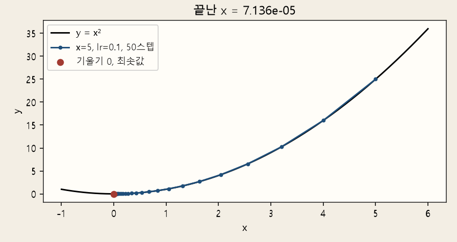

공책의 예제는 `x = 5`, 학습률 `0.1`, 50스텝이다. 한 스텝마다 `x`는 0.8배가 된다. 이 PC에서 다시 돌리면 앞부분은 5, 4.0, 3.2, 2.56, 2.048이고, 50스텝 뒤는 `7.14e-5`다.

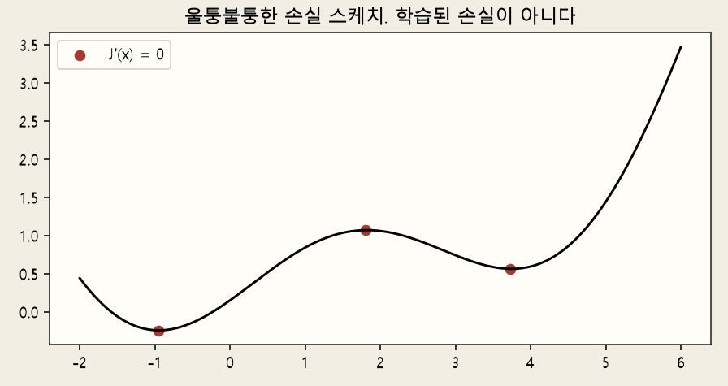

아래 곡선은 학습된 손실이 아니다. 노트북에 적어 둔 스케치 `sin(t) + 0.15(t-1)²`이고, 빨간 점은 그 식의 도함수가 0인 곳이다.

## 기하와 ReLU

이동은 벡터를 더하는 일, 회전은 회전 행렬, 스케일은 대각 행렬이다. 공책의 y 배율 -0.5는 위아래를 뒤집으며 절반으로 줄인다는 뜻이다. 선형 변환 뒤에 이동을 붙이면 아핀 변환 `y = Wx + b`다.

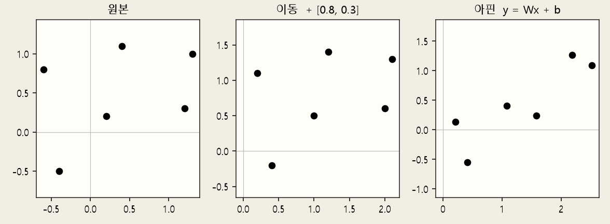

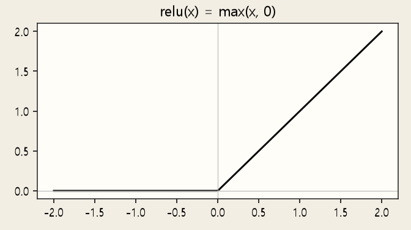

`relu(x) = max(x, 0)`. 음수를 0으로 눌러 비선형을 만든다. MNIST 첫 층의 `activation="relu"`가 이 함수다.

## 이 PC에서 다시 잰 덧셈

공책에는 400×400에서 `x + y`가 약 0.003초, `naive_add`가 약 2.45초라고 적혀 있다. 2026-11-10, 같은 크기·`float32`·시드 0으로 이 PC에서 다시 재면 NumPy 덧셈 0.000297초, 파이썬 이중 루프 0.060초였다. 두 결과가 같은지는 `allclose`로 확인했다. 루프가 훨씬 느리다는 결론은 같고, 절대 시간은 기계마다 다르다.

```text
python code/check_basics.py
```

`numpy`, `matplotlib`만 있으면 된다. 의존성은 [requirements.txt](requirements.txt).

## 공책 원본

2026-11-01. 세 갈래, 좌표 변환, 가설 공간.

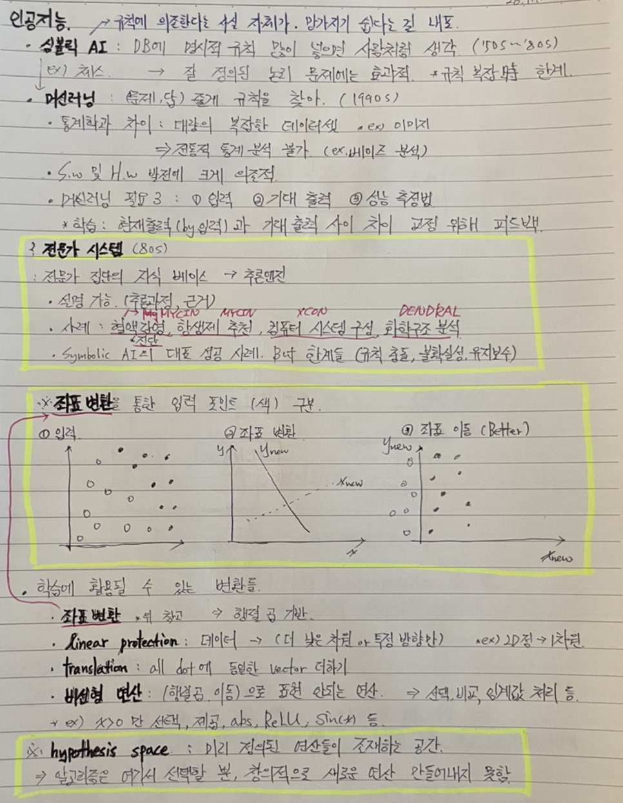

딥러닝 루프. 노란 상자 두 개와, 빨간 펜으로 적은 역전파.

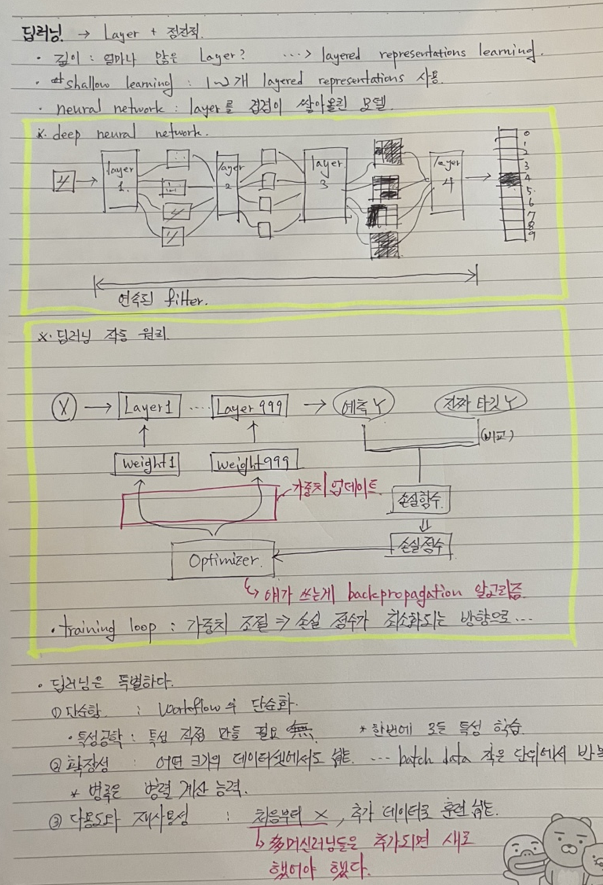

생성형 쪽 메모. 자기지도학습, 파운데이션 모델, fuzzy database, 인지적 자율성, AGI, 투자와 수익.

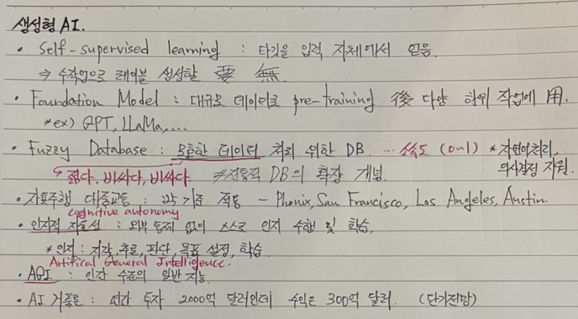

2026-11-06. 텐서 랭크. MNIST는 랭크 3, 채널을 붙이면 랭크 4.

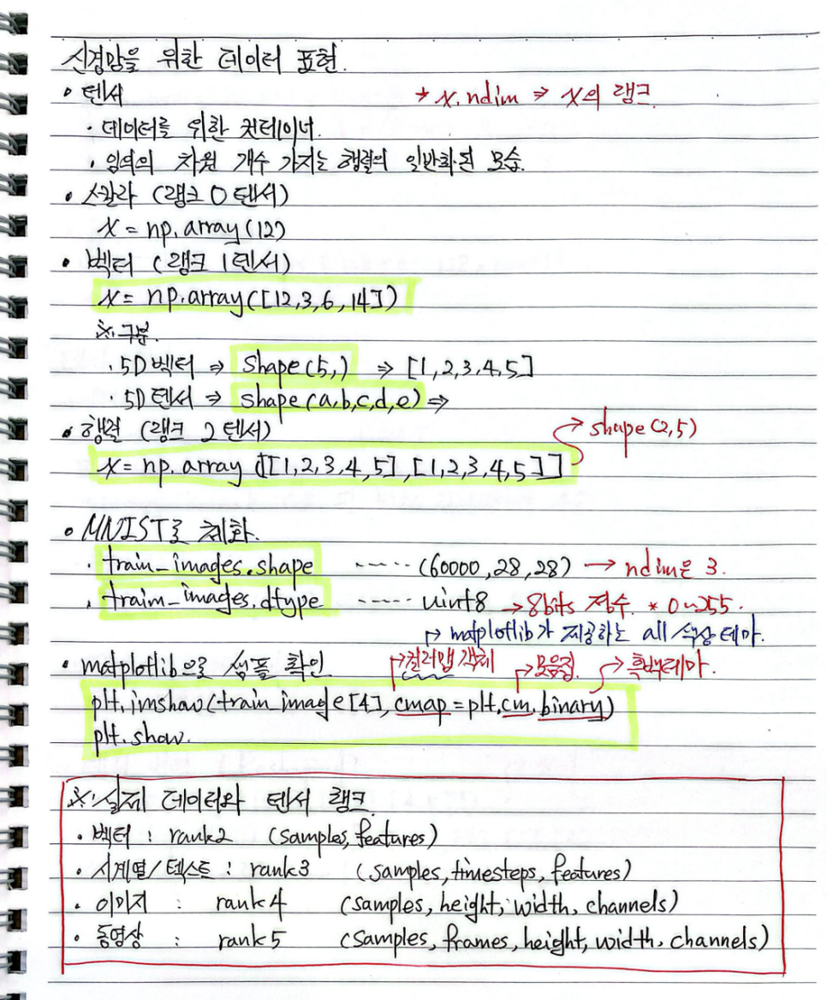

슬라이싱, 배치, `naive_add`에 적어 둔 시간, `@`, reshape.

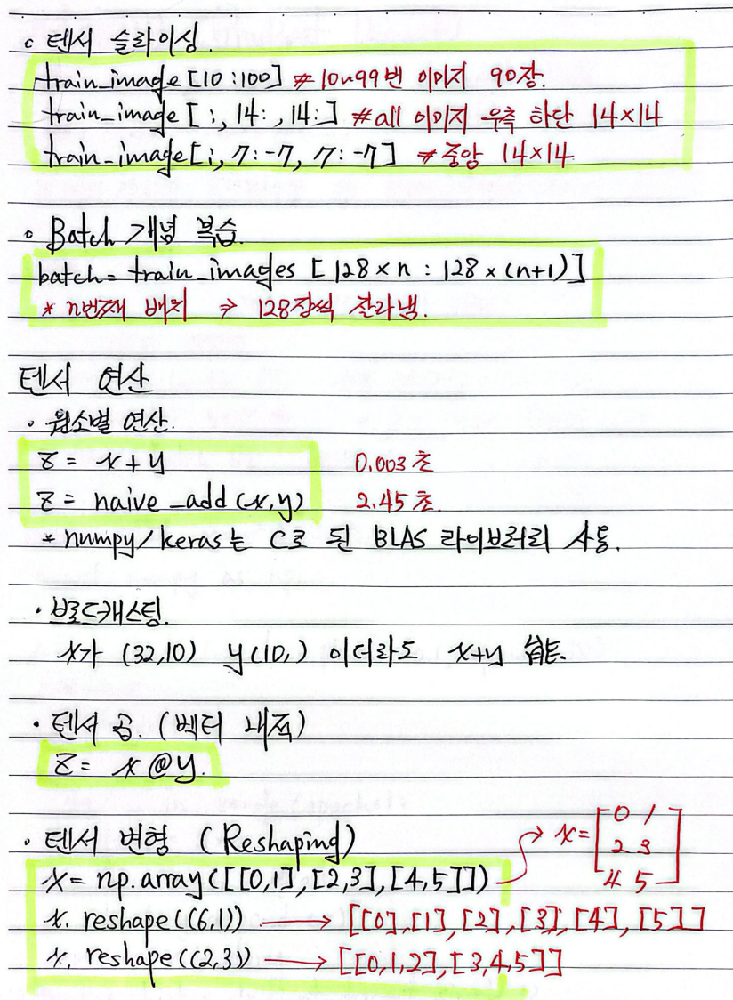

이동, 회전, 스케일, 아핀, ReLU.

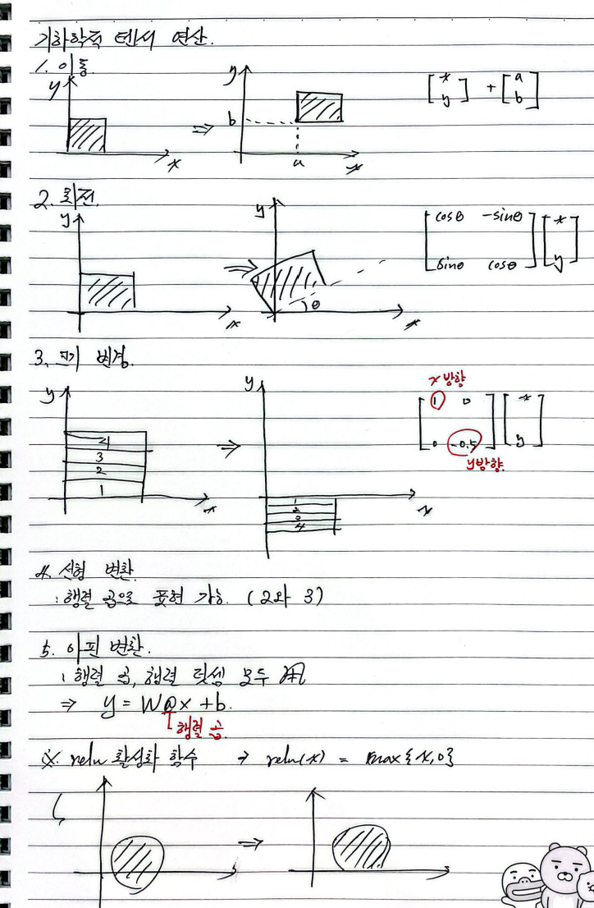

경사하강 식과 `y = x²` 예제.

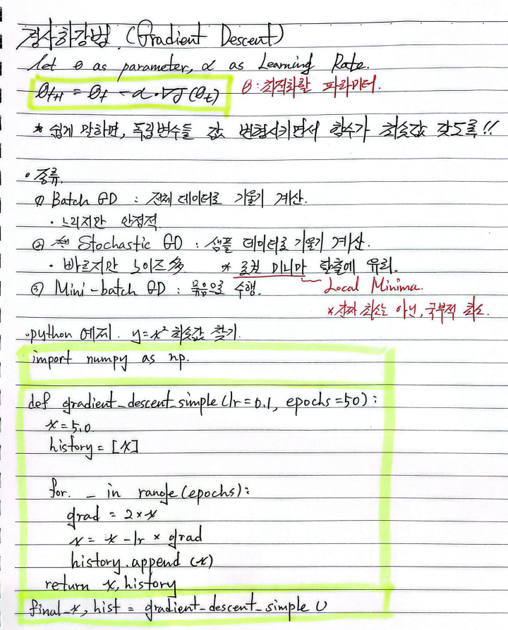

기울기가 0인 곳을 손으로 표시한 스케치.

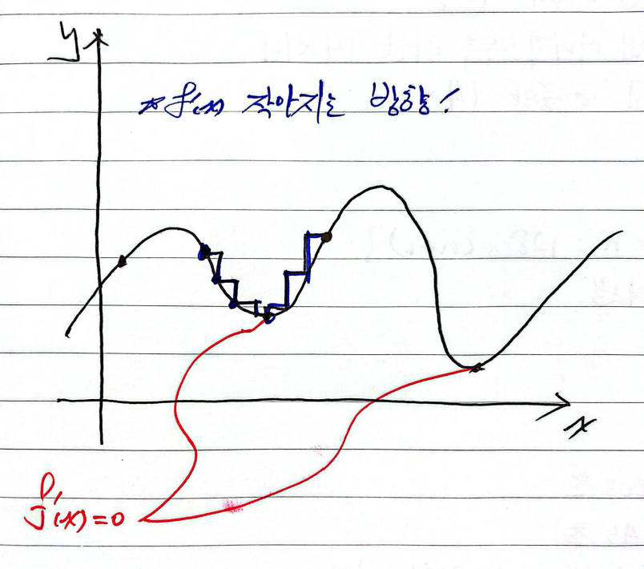
